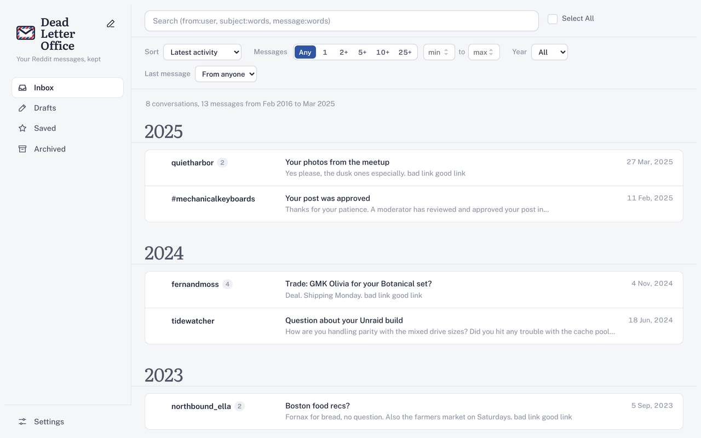
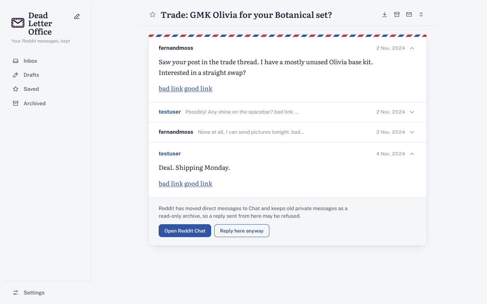
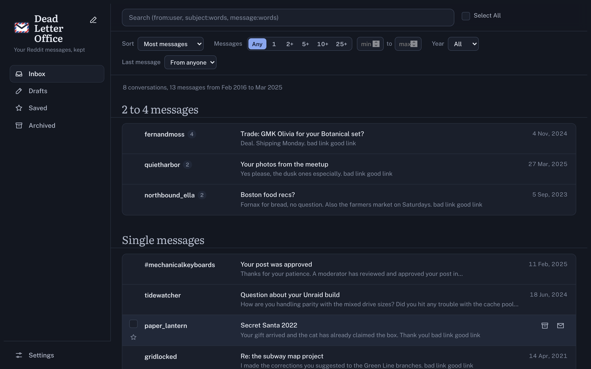

# Dead Letter Office

**A searchable, exportable archive of your Reddit private messages.**

Reddit moved direct messages to Chat and turned years of private messages into a read-only archive that's slow to browse and impossible to search. Dead Letter Office keeps a complete copy of that archive in your browser and gives it a proper reading room: search, folders, sorting by thread length, and exports you can keep.



## What it does

* **Reads your whole archive.** It walks Reddit's PM archive, then opens every conversation and follows its "load more" pages, so even 700-message threads come in complete. After the first run it only re-reads conversations with new activity.
* **Search** as you type, ignoring case and accents. Use `"exact phrases"`, `-exclude`, `OR`, `from:`/`to:`/`with:`, `subject:`/`message:`, `before:`/`after:`/`during:` dates, `messages:>20`, `has:link`, and `is:saved` (the full list drops down when you click into the search box). Results show the message that matched, and opening one jumps you to each match in turn.
* **Sort and filter** by latest activity, when a conversation started, most or fewest messages, or name, and narrow by message count (1, 2+, 5+, 10+, 25+, or any range), year, and who wrote last. Sorting by *Most messages* is the quickest way to find your longest conversations.
* **Folders** for Saved, Archived, and Drafts, plus bulk actions.
* **Read comfortably.** Conversations open as a letter at a readable width, in Literata, with light, dark, or match-system themes.
* **Export** a single conversation as text, or everything as text or JSON (with your saved and archived flags) from **Settings → Administration**.
* **Unread badge.** The toolbar button shows unread messages and has an **Open inbox** button.
* **Keyboard friendly.** Use `j`/`k` to move, `Enter` to open, `x` to select, `/` to search, and `Esc` to go back.



Everything stays on your computer. The extension only talks to reddit.com, using the login you already have.

## Install

1. Download the latest `dead_letter_office-<version>.zip` (or build it, below) and unzip it.
2. **Chrome, Edge, or Brave:** open `chrome://extensions`, turn on *Developer mode*, click *Load unpacked*, and choose the unzipped folder (the one with `manifest.json` in it).
3. **Firefox (121+):** open `about:debugging#/runtime/this-firefox`, click *Load Temporary Add-on…*, and choose `manifest.json`. Allow access to reddit.com when asked.
4. Log in to Reddit and open <https://old.reddit.com/message/dlo_inbox>, or click the toolbar button and choose **Open inbox**. The first visit reads your whole archive, which can take a few minutes for a large one.

To update, replace the files in the same folder and click reload on the extension's card. Keeping the same folder keeps your stored messages, flags, and settings.



## Development

```sh
npm install
npm run lint            # ESLint (undefined names, MV3 service-worker misuse)
npm run lint:firefox    # Mozilla's add-on linter
npm run test:e2e        # drives the extension in Chromium against a mock Reddit (needs openssl)
npm run build           # zips the extension into dist/
```

There is no bundler: the files listed in `manifest.json` are loaded as they are.

* `js/background/` runs as a service worker in Chrome (`service-worker.js` imports the other files) and as an event page in Firefox (the `background.scripts` list); keep the two lists in sync. It owns persistent state (`chrome.storage.local` and one IndexedDB database per Reddit user) and fetches from Reddit.
* `js/content-inbox/` renders the archive on `old.reddit.com/message/dlo_*` pages. `dbhelper.js` reads Reddit's archive (`www.reddit.com/message/messages/`, its `pm-archive` list pages, each conversation's page, and its `pm-archive-message-replies` chunks).
* Content scripts call the background through `yair.proxy([...path], params, callback)`; only paths in `PROXY_WHITELIST` (`bg-proxy.js`) are allowed.
* `css/yair.css` is the whole theme (colour tokens at the top, light and dark). Icons are inline SVG. Fonts (Public Sans and Literata, SIL OFL) live in `fonts/`.
* Internal names still use the `yair` prefix from the project this grew out of; old `/message/yair_*` addresses redirect to `/message/dlo_*`.

Publishing to addons.mozilla.org needs an add-on ID under `browser_specific_settings.gecko.id` in `manifest.json`.

## Credits

Dead Letter Office is a fork of [YAIR](https://github.com/adhesivecheese/YAIR) (Yet Another Inbox Revamp) by [/u/AdhesiveCheese](https://www.reddit.com/user/adhesivecheese), which was built on [Goctionni's Reddit Inbox Revamp](https://github.com/Goctionni/RedditInboxRevamp) and includes code from [Reddit Notifier](https://github.com/kaypoz/reddit-notifier), [Quill](https://github.com/quilljs/quill), [Turndown](https://github.com/mixmark-io/turndown), [SnuOwnd](https://github.com/JordanMilne/snuownd), and [jQuery Grab Bag](https://github.com/jaz303/jquery-grab-bag). Fonts are [Public Sans](https://github.com/uswds/public-sans) and [Literata](https://github.com/googlefonts/literata).

MIT licensed; see [LICENSE](LICENSE). Not affiliated with or endorsed by Reddit.
